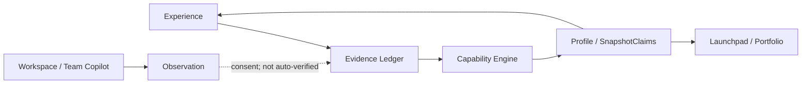

# 00 — Vision & Principles

**Status:** Permanent governance  
**Audience:** Everyone  
**Canonical detail:** [`architecture/00-deliverx-foundation.md`](./architecture/00-deliverx-foundation.md)

---

## Why DeliverX exists

Professional development is fragmented. Learning platforms teach. Recruitment platforms hire. Companies evaluate. Portfolio tools showcase. Performance tools review. None share a common understanding of demonstrated capability.

DeliverX exists to turn that into one continuous, **evidence-driven** professional journey.

**Instead of asking:** “Can this person do the job?”  
**DeliverX answers:** “What has this person consistently demonstrated, how have they grown, and what is the most credible next step?”

---

## Evidence-first philosophy

DeliverX is a **Professional Intelligence Operating System**, not a learning platform, interview platform, project simulator, portfolio app, or generic AI chat.

- Demonstrated capability beats self-declared skills.  
- Knowledge, evidence, and capability are separate concepts.  
- AI assists, coaches, observes, and explains — it never fabricates evidence.  
- Learning alone is insufficient; capability grows through applied work and judgement.  
- Trust and explainability beat engagement theatre.

---

## Five candidate questions

Every important surface should help the user answer:

1. Who am I professionally?  
2. What have I genuinely demonstrated?  
3. What evidence supports my capability?  
4. How have I improved, and what should I develop next?  
5. What opportunities best align with my strengths?

---

## Product ecosystem

| Product | Role |
| --- | --- |
| **Professional Intelligence** | Permanent evidence-backed profile — shared source of truth |
| **Experience** | Environment where capability develops through realistic work |
| **Launchpad** | Converts evidence into career packaging and opportunities |
| **Team Copilot** | Collaborative delivery / Professional Workspace (alias — not a third SKU under current charter) |

Everything either **generates** Professional Intelligence or **consumes** it. Nothing else belongs.

---

## Decision filter (refuse features)

Every proposed feature must answer **yes** to all five:

1. Does it strengthen Professional Intelligence?  
2. Does it generate or consume trustworthy evidence?  
3. Does it improve professional capability or career outcomes?  
4. Does it fit naturally within Experience, Launchpad, or Team Copilot / Workspace?  
5. Can it be explained clearly to both a candidate and an employer?

If any answer is **no** → redesign or defer.

### Explicit refuse list (agents)

Do **not** implement when the request:

- Contradicts the [Build Charter](./product/build-charter.md)  
- Presents AI claims or observations as verified evidence  
- Treats learning completion as capability or lights Verified from ScoreRun alone  
- Introduces unexplained scores or decorative readiness % as capability truth  
- Uses chat history as the primary database  
- Adds a third SKU, marketplace liquidity, or enterprise mission-control depth without approval  
- Starts **T9 / commercial / Stripe** without separate founder approval  

Cite this document + Build Charter and stop.

---

## Lexicon

| Term | Meaning |
| --- | --- |
| Knowledge | What a user knows (exposure) |
| Evidence | Observable proof supporting a capability claim |
| Capability | What a user has repeatedly demonstrated |
| Experience | Environment where evidence is generated |
| Professional Intelligence | Continuously updated model of professional capability |
| Launchpad | Career acceleration / packaging experience |
| Team Copilot | Collaborative work experience (Workspace alias in-app) |

---

## Shipped reality

> Pilot loop **P0–P7** and technology **T0–T8** are largely **shipped** (migrations `0066`–`0094`). Foundation principles are enforced via append-only Evidence Ledger, Capability Engine–only ScoreRuns, observation consent default OFF, Learning ≠ competency, and `deliverxVerified` gated on external attestation (T8).

Active charter work is **ops + trust hardening**, not rebuilding Stage 3–4 of the long-term vision. See [`15-delivery-roadmap.md`](./15-delivery-roadmap.md).

---

## Reading order

See [`README.md`](./README.md). Agents: `00` → Build Charter → Current Scope → relevant `01`–`15` → engineering detail → product decisions.
