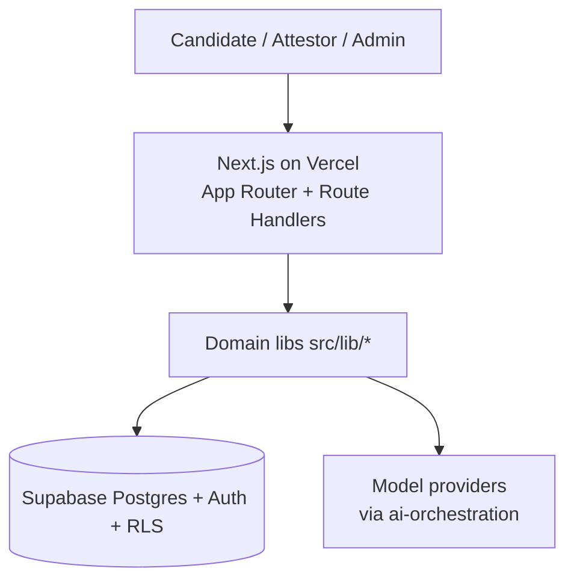
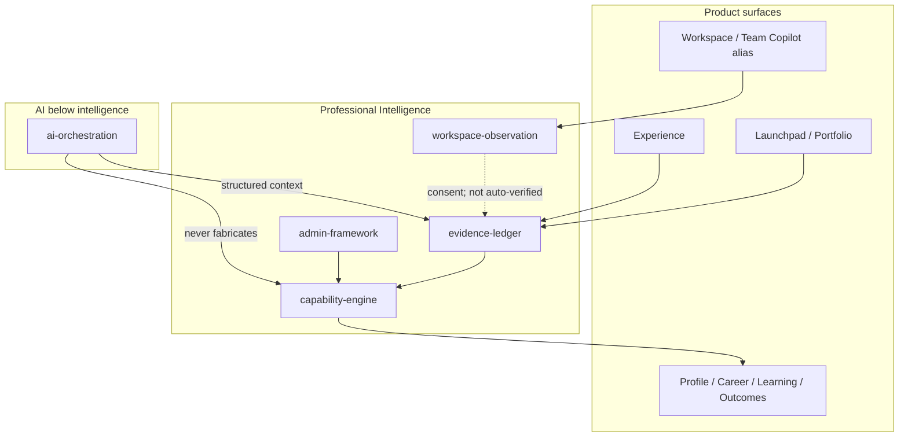

# 11 — Technical Architecture

**Status:** Active engineering architecture  
**Canonical detail:** [`engineering/system-architecture.md`](./engineering/system-architecture.md) · [`engineering/security-model.md`](./engineering/security-model.md)

---

## Context

DeliverX is a **modular monolith**: one Next.js deployable owns web UI, Route Handlers, and domain libraries. Supabase provides Postgres, Auth, and RLS. Prefer this shape until scale justifies extraction.

Production: https://www.deliverx.dev · Supabase project `jibmyxaldetyycmtlxet` · migrations head `0094`.

---

## Containers

```mermaid
C4Context
  title DeliverX containers (simplified)
```



---

## Modules (PI SoT)



Hard boundaries:

- Only Capability Engine persist writes ScoreRuns / levels  
- Learning and outcomes must not upgrade capability or Verified  
- Products read SnapshotClaims; do not duplicate capability stores  
- Pre-pivot delivery/org code must not override PI SoT  

---

## Events

- `pi_domain_events` — outbox-style within the monolith  
- Not a cross-service pub/sub fabric  

## AI orchestration

Registry of agents + prompt versions; `runAgent` with guardrails; interactions append-only. See [`09-ai-and-intelligence.md`](./09-ai-and-intelligence.md).

## Storage

- Relational Postgres with explicit schemas  
- No graph database (deferred)  
- Artefact versions immutable; evidence cites version ids  

## Security

Session auth · RLS · consent · attestation tokens · SECURITY DEFINER grant hygiene. Detail: [`engineering/security-model.md`](./engineering/security-model.md).

## Deploy

| Layer | Platform |
| --- | --- |
| Web/API | Vercel |
| Data/Auth | Supabase |
| CI | GitHub Actions `verify.yml` + Playwright workflow (re-enable after TD-018 minutes) |

---

## Anti-goals

- Microservice split of “ten intelligence domains”  
- Chat-as-database  
- Agent swarms as SoT  
- Lighting Verified without attestation  

---

## Related

- Entity catalogue: [`12-database-and-data-model.md`](./12-database-and-data-model.md)  
- Technology phases: [`engineering/technology-build-phases.md`](./engineering/technology-build-phases.md)  
