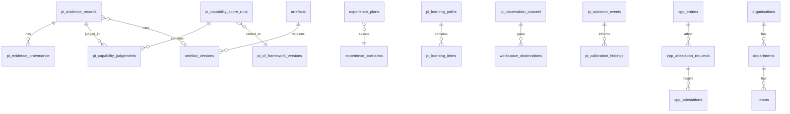

# 12 — Database & Data Model

**Status:** Summary catalogue · **canonical detail:** [`engineering/data-model.md`](./engineering/data-model.md)  
**Migrations:** `0066`–`0094` on Supabase `jibmyxaldetyycmtlxet`  
**As of:** 2026-07-25

> Implement against `docs/engineering/data-model.md` and migration SQL. This bible chapter is the orientation layer.

---

## High-level ER

---

## Entity catalogue (summary)

| Domain | Tables (representative) | Ownership | Lifecycle notes |
| --- | --- | --- | --- |
| Onboarding | `pi_onboarding_sessions` | Person | Progressive payload; completable |
| Evidence Ledger | `pi_evidence_*`, `pi_domain_events` | Person | Append-oriented; provenance; challenges |
| Capability | `pi_capability_score_runs`, judgements, snapshots, reviews | Person | Engine-only writes; pin + `run_kind` |
| Framework | `pi_cf_*` | Platform catalogue | Versioned; never person-purged |
| Assessment | `pi_assessment_*`, `pi_work_samples`, `pi_growth_reports` | Person | baseline/final/transfer |
| Experience | `experience_scenarios`, `experience_plans`, `experience_sim_events` | Catalogue + person plans | Seeded scenarios shared |
| Workspace | `workspace_contributions`, observation/consent/interventions | Person | Consent default deny |
| Learning | `pi_learning_paths`, `pi_learning_items` | Person | No capability persist |
| Outcomes | `pi_outcome_events`, `pi_calibration_findings` | Person | Honest calibration |
| Artefacts | `artefacts`, `artefact_versions`, `artefact_status_transitions` | Person | Prior versions immutable |
| Portfolio | `vpp_entries`, evidence links, versions, shares | Person | Private default |
| Attestation T8 | `vpp_attestation_requests`, `vpp_attestations`, `vpp_attestation_events` | Person + token attestor | Confirm→ledger; dispute→review |
| Career | `career_applications`, `career_activities` | Person | Packaging |
| Review | `pi_review_cases`, events, notifications bridge | Person / admin | Challenge path |
| Privacy | `pi_privacy_requests` | Person | Tombstones retained; purge RPC service_role |
| AI | `ai_agents`, `ai_prompt_versions`, `ai_interactions` | Platform + person interactions | Append-only interactions |
| Notifications | `pi_notifications` | Person | Self RLS; no client DELETE |
| Org T7 | `departments`, `teams`, memberships | Org-scoped | No capability assignment |

---

## Cross-cutting rules

| Concern | Rule |
| --- | --- |
| Soft delete | Prefer status transitions / tombstones over silent erase; privacy purge is explicit RPC |
| Audit | Domain events + attestation events + framework audit |
| Constraints | Evidence→artefact must cite `artefact_version_id`; ScoreRuns pin `framework_version_id` |
| RLS | Person self-only for PI; org helpers for structure; public tokens least privilege |

---

## Migration map (PI pivot+)

| Range | Theme |
| --- | --- |
| 0066–0076 | Onboarding, ledger, capability, sim, workspace, portfolio, career, review, framework seed/pin |
| 0077–0082 | Assessment + final/transfer |
| 0078–0079 | Experience planner + catalogue |
| 0080 | Observation |
| 0083–0085 | Learning + outcomes |
| 0086–0089 | Privacy, rubric audit, artefacts, purge lockdown |
| 0090–0092 | AI orchestration, notifications, SECURITY DEFINER grants |
| 0093 | Org structure |
| 0094 | External attestation |

---

## Deferred

Full published Mermaid ER export (TD-013); first-class `messages` table.
