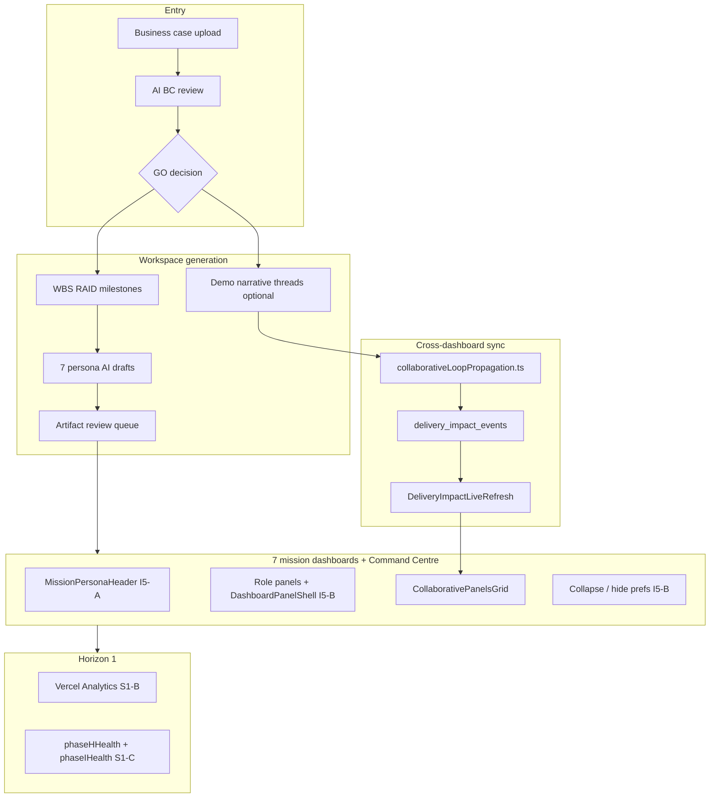

# Collaborative loop status

**Last updated:** 2026-06-19 (Sprint S1-D)  
**Production:** https://www.deliverx.dev  
**Current `main` SHA:** see `git log -1 origin/main`

Honest assessment of the **Collaborative Loop explainer** (7-role propagation, narrative threads, approval gate) against what is built and running in production. For sprint history and PR numbers, see [BUILD_REPORT.md](./BUILD_REPORT.md).

---

## Verdict

The loop is **architecturally built** — engine, panels, impact events, propagation module, realtime refresh, and GO → bootstrap → approval path. It is **not yet a fully closed, event-driven loop** where every user action ripples across dashboards without demo seeding or mock fallbacks.

---

## Spec vs built matrix

| Spec section | Built | Partial | Not built | Notes |
|--------------|:-----:|:-------:|:---------:|-------|
| 7 persona mission dashboards | ✅ | | | All routes + Command Centre; `CollaborativePanelsGrid` on every mission page |
| Stakeholder Loop / Team Needs / Pulse panels | ✅ | | | Persona-specific panels via `collaborativeLoopEngine.ts` |
| Business case → GO gate | ✅ | | | Sponsor gateway, AI BC review, Accept GO / No-Go |
| AI workspace generation on GO | | ✅ | | `projectBootstrap.ts` structures project + persona AI drafts; counts vary |
| Human approval gate | ✅ | | | `/workspace/proposals`, `/workspace/audit`, inline approve on dashboards |
| Cross-dashboard propagation (`delivery_impact_events`) | | ✅ | | Realtime + live refresh wired; many flows still demo-seeded |
| 13-step loop table (every arrow = live feed) | | ✅ | | Bootstrap path strong; ongoing project events incomplete |
| Three narrative threads (Auth API, defects, FR-003) | | ✅ | | Codified in `collaborativeLoopPropagation.ts`; demo seed on bootstrap |
| Meeting intelligence (Recall) | ✅ | | | G3 — needs Recall env on deploy |
| AI agents per role (4 quick actions) | | ✅ | | Persona AI services exist; not all surfaced as quick-action chips |
| Day-in-the-life narrative (Section 6) | | | ✅ | Not one automated simulation |
| 21 prototype screens / pixel parity | | ✅ | | Core routes exist; diverged from HTML prototype |
| “No manual status updates” | | | ✅ | Aspirational — many writes still manual or approval-gated |
| Investment Intelligence Engine UI (Section 3.1) | | ✅ | | Engine output exists; presentation not 1:1 with explainer grid |
| Go-live → knowledge graph | | | ✅ | Phase 5 tables exist; loop not wired as described |

**Legend:** ✅ = production-ready for this slice · Partial = infra or UI exists, E2E incomplete · Not built = missing or aspirational only

---

## Architecture (today)



**Strongest E2E path today:**

```
Register → role onboarding → (Executive) business case → GO
  → projectBootstrap.ts → structure + persona AI drafts
  → artifact review queue → approve outputs
  → mission dashboards with loop panels + impact feed
  → optional demo narrative threads (Auth API, defects, FR-003)
```

---

## Three narrative threads — demo seed vs live

| Thread ID | Title pattern | Demo seed | Live wiring | Roles reached |
|-----------|---------------|:---------:|:-----------:|---------------|
| `auth-api-blocker` | Auth API blocker on blocked task | ✅ `seedNarrativeThreadDemoData` on bootstrap | ✅ Blocked tasks (priority-ranked) | Engineer, PM, Scrum, Founder |
| `critical-defects` | Critical open defects (BUG-142 style) | ✅ Demo defects seeded | ✅ All critical open defects | QA, Engineer, PM, Scrum |
| `fr003-gdpr-gap` | FR-003 GDPR clarification gap | ✅ Demo requirement + clarification | ✅ Pending clarification / compliance flags + open clarifications | BA, Engineer, QA, Scrum |

**Resolver:** `resolveNarrativeThreads()` in `src/services/collaborativeLoopPropagation.ts`  
**Smoke test:** `runCollaborativeLoopPropagationSmokeTest()` — 3 threads, ≥3 roles (also checked in `phaseIHealth.ts` and `phaseHHealth.ts`)

**Honest limit:** Thread IDs are stable, but **signal loading now queries live blocked tasks, critical defects, and compliance/clarification gaps** instead of fixed FR-003/BUG-142/Auth API patterns. Demo seed still uses NHS-specific codes for bootstrap parity; organic mutations emit impact via J1 wiring.

---

## J2 — Live narrative threads (foundation)

| Area | Before | After (J2 foundation) |
|------|--------|------------------------|
| Blocked task signal | `title`/`blocked_reason` ilike `%Auth API%` | Any `status=blocked`, highest priority first |
| Critical defects | Only `BUG-142`, `BUG-167` | All `severity=critical` and `status≠closed` |
| Compliance gap | `req_code=FR-003`, GDPR question, `US-49` | `pending_clarification` / compliance flags + open clarifications + blocked linked stories |

**Still pattern-based:** Thread IDs (`auth-api-blocker`, `fr003-gdpr-gap`), demo seed entity codes (FR-003, US-49, BUG-142), and J1 mutation draft heuristics (e.g. Auth API substring for founder alerts).

---

## Next steps — Horizon 2 (J1–J4)

These sprints close the gap between the explainer and live product behaviour. Horizon 3 **K1–K5** covers UX/wordiness (panel diet, “next up” strip); see [BUILD_REPORT.md](./BUILD_REPORT.md) deferred table.

| Sprint | Goal | Exit criteria |
|--------|------|---------------|
| **J1** — Event-driven propagation | Real DB changes emit `delivery_impact_events` without demo seed | Vitest “Auth API blocker” passes without `seedNarrativeThreadDemoData`; PM Team Needs update from real task state |
| **J2** — Live narrative threads | Wire thread resolver to blocked tasks, critical defects, open clarifications | Three thread IDs unchanged; signal queries use semantic categories (blocked / critical / compliance) |
| **J3** — Founder command surface | Decision Centre inline approve + intelligence feed (7 items max) | ✅ Foundation: live decisions + `buildFounderIntelligenceFeed` (impact + agent events), inline approve/reject, `DeliveryImpactLiveRefresh` via workspace layout |
| **J4** — Bootstrap parity UI | Post-GO checklist with **actual** bootstrap counts | New sponsor sees loop panels update from **their** actions, not NHS demo only |

**Recommended order after S1:** J1 → J2 → K2 (panel diet) → K1 → J3 → K3 → J4

---

## Health checks

| Module | Covers |
|--------|--------|
| `phaseHHealth.ts` | H1–H3 collaborative loop spine, propagation smoke, live refresh file, migrations |
| `phaseIHealth.ts` | I5-A/B/C/D artifacts, mission chrome wiring, loop layout wiring, S1-B observability |

Run locally:

```bash
npm test -- --run src/services/phaseHHealth.test.ts src/services/phaseIHealth.test.ts
```

API (authenticated): `GET /api/setup/phase-h-health`, `GET /api/setup/phase-i-health`

---

## Related docs

- [BUILD_REPORT.md](./BUILD_REPORT.md) — sprint PR index and deferred items
- [I4_STAKEHOLDER_MATRIX.md](./I4_STAKEHOLDER_MATRIX.md) — persona routes and mock-data banners
- [ARCHITECTURE_AUDIT.md](./ARCHITECTURE_AUDIT.md) — full loop coverage audit
- [PREVIEW_ENV_PARITY.md](./PREVIEW_ENV_PARITY.md) — Preview env follow-up
