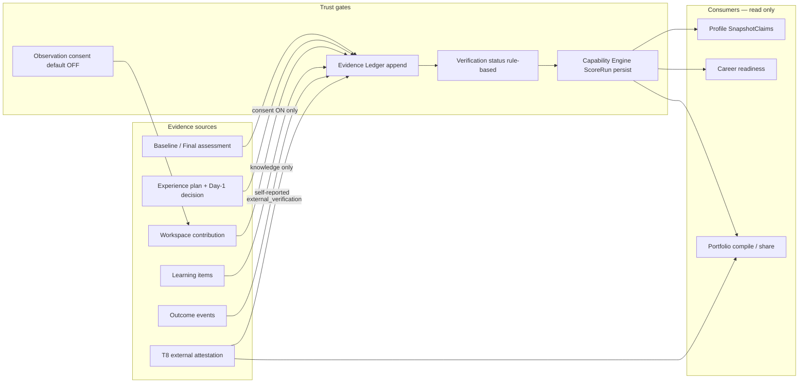

# Phase 1 — Data flow map

**Date:** 2026-07-25 · Schema SoT: migrations `0066`–`0094` · Prod project `jibmyxaldetyycmtlxet`

---

## Core evidence → capability → packaging loop



**Invariants (enforced in app + SQL):**

1. AI observation ≠ evidence ≠ capability.  
2. Capability levels only via ScoreRun persist.  
3. Learning / outcomes must not call capability persist (T6 security live).  
4. `deliverxVerified` only when externally attested + externally verified + kill switch on.  
5. Evidence citing artefacts must include `artefact_version_id` (T3).

---

## Auth session flow

```text
Browser → Supabase Auth (email/password)
       → SSR cookies (@supabase/ssr)
       → Page layout getUser() → allow or redirect /login?next=
       → API route-handler createClient → 401 if no user
```

OAuth callback exists (`/auth/callback`) but social providers are not productized in UI.

---

## Privacy cascade

```text
User confirms phrase + password → POST /api/pi/privacy/delete
  → service_role RPC pi_privacy_purge_person_data*
  → person PI tables purged; pi_cf_* retained; privacy tombstones retained
  → auth user delete (harness)
```

Verified live T6 step 18. Anon/authenticated EXECUTE on purge RPC denied (T6 security).

---

## Experience planner flow

```text
Gaps from ScoreRun (or empty guidance)
  → POST /api/pi/experience-plan
  → ranks experience_scenarios (16 / 12 companies)
  → Day-1 decide via xperience/sim APIs
  → appendEvidence (decision) → ledger
```

Live T6 used `brightpath-adaptive` with `gaps=0` (honest empty intervention path).

---

## Observation / coach flow

```text
No pi_observation_consent row ⇒ denied
Consent ON → workspace contribution → workspace_observations
  → may create pi_interventions (drafts)
  → evidence only via rule path; never auto-Verified
```

---

## Launchpad / Career read path

```text
GET /api/career/intelligence
  → prefer SnapshotClaims / ScoreRun
  → else labelled evidence_coverage_heuristic or mixed
  → UI must show readinessSource label
```

Opportunities / interview / CV modules largely derive from this aggregate — not a separate employer marketplace DB (0 `launchpad_*` person rows in prod).

---

## T8 attestation flow

```text
Owner requests attestation (consent) → vpp_attestation_requests (token)
Attestor opens /portfolio/attest/[token]
  confirm → ledger external_verification + entry externally_attested
  dispute → pi_review_case
Public share strips private evidence + attestor PII
```

**Prod rows:** 0 requests / attestations. API validates tokens (fake → `not_found`). Full happy-path **not** covered by T6 loop (loop only asserts Verified stays off).

---

## Pre-pivot delivery data (parallel island)

```text
organisations → projects → requirements / tasks / meetings / RAID / …
  → twin_snapshots / coordination_runs / global_* (cron)
```

Must **not** write `pi_capability_*`. Risk: product confusion when marketing shows persona dashboard mock % (`landing-data.ts` preview fixtures).

---

## Domain event / notification path

```text
Ledger / review / intervention / privacy domain events
  → pi_notifications (T5) with contextual href
  → Profile NotificationInbox
```

---

## Storage & AI log

| Flow | Tables |
| --- | --- |
| Artefact submit | `artefacts` → immutable `artefact_versions` → optional evidence cite |
| AI orchestration | `ai_interactions` append-only; catalogue `ai_agents` / `ai_prompt_versions` |
| Daily AI usage view | `pi_ai_usage_daily` (security_invoker) |

---

## Prod data posture (audit snapshot)

| Class | Signal |
| --- | --- |
| Catalogue / seed | Framework + 16 scenarios + 6 AI agents present |
| Person PI | Empty after disposable T6 purge (expected) |
| Privacy tombstones | `pi_privacy_requests` = 7 (prior QA) |
| Legacy OS | Non-zero twin/coordination/global rows — historical crons |
| Attestation | Empty — path unexercised by real users |

---

## Failure points (where data flow breaks in practice)

| Point | Mode | Severity |
| --- | --- | --- |
| Consent OFF | Observation silently does not create rows | Expected honesty |
| Gaps empty | Interventions offered=0 | Expected (T6 logged) |
| Rubric DB missing | `in_code_fallback` labelled or fail-closed | Ops |
| Marketing → signup → no pay | User expects purchase | P0 honesty |
| Attestation unused | Verified never lights in pilot | Expected until employers invited |
| Dual Experience surfaces | `/experience/app` vs legacy xperience | P2 confusion |
