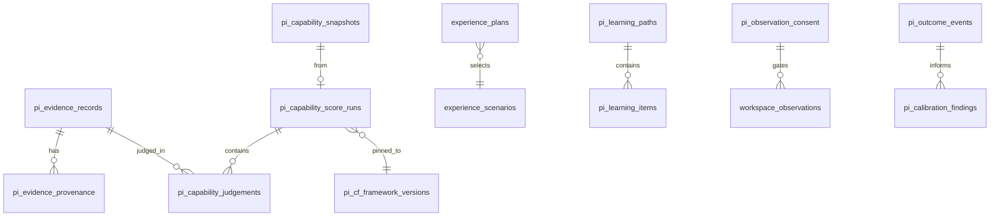

# Data Model

**Source of truth:** `supabase/migrations/0066`–`0085` (PI pivot) on project `jibmyxaldetyycmtlxet`  
**As of:** 2026-07-25

Mermaid ER diagram: **TODO** (compact domain sketch below until a full ER export is generated).

---

## Compact domain sketch

---

## Tables by domain (migrations 0066–0085)

### Onboarding — `0066`

- `pi_onboarding_sessions`

### Evidence Ledger — `0067`

- `pi_evidence_sources`
- `pi_evidence_records`
- `pi_evidence_provenance`
- `pi_evidence_status_transitions`
- `pi_evidence_interpretations`
- `pi_evidence_competency_links`
- `pi_evidence_processing_jobs`
- `pi_evidence_challenges`
- `pi_domain_events`

### Capability Engine — `0068`

- `pi_rubric_versions`
- `pi_capability_score_runs` (includes `framework_version_id`, `run_kind`)
- `pi_capability_judgements`
- `pi_capability_snapshots`
- `pi_capability_reviews`

### Experience simulation — `0069`

- `experience_sim_events`

### Professional Workspace — `0070`

- `workspace_contributions`

### Verified Portfolio — `0071`

- `vpp_entries`, `vpp_entry_evidence`, `vpp_versions`, `vpp_shares`

### Career Intelligence — `0072`

- `career_applications`, `career_activities`

### PI Review — `0073`

- `pi_review_cases`, `pi_review_events`, `pi_review_notifications`

### Admin competency framework — `0074`–`0076`

- `pi_cf_frameworks`, `pi_cf_framework_versions`
- `pi_cf_role_families`, `pi_cf_seniority_levels`, `pi_cf_roles`
- `pi_cf_competencies`, `pi_cf_indicators`, `pi_cf_rubric_anchors`
- `pi_cf_assessment_content`, `pi_cf_evidence_rules`
- `pi_cf_portfolio_expectations`, `pi_cf_readiness_requirements`
- `pi_cf_audit_events`
- Seed graph + framework pin backfill

### Assessment — `0077`, `0081`–`0082`

- `pi_assessment_sessions`, `pi_assessment_items`, `pi_assessment_responses`, `pi_work_samples`
- `pi_growth_reports` (final/transfer body)

### Experience planner / catalogue — `0078`–`0079`

- `experience_scenarios`, `experience_plans`
- Multi-company catalogue seed (12 companies)

### Workspace observation — `0080`

- `pi_observation_consent`
- `workspace_observations`
- `pi_interventions`, `pi_intervention_outcomes`

### Learning Intelligence — `0083`

- `pi_learning_paths`, `pi_learning_items`

### Real-world outcomes — `0084`–`0085`

- `pi_outcome_events`, `pi_calibration_findings`

---

## Key invariants / CHECKs (enforced in SQL + app)

| Invariant | How |
| --- | --- |
| Append-oriented evidence history | Ledger transitions + provenance tables; forbid silent capability invent |
| Capability only via ScoreRun persist | App invariant + engine persist entry points |
| Framework pin | `framework_version_id` on ScoreRuns when published pin exists |
| `run_kind` ∈ standard/baseline/final/transfer | Persist + assessment paths |
| Consent default deny | No `pi_observation_consent` row ⇒ observation denied |
| Learning ≠ competency | Learning persist never writes ScoreRuns |
| Outcomes ≠ external verification without attestation | Strength derivation + `externally_verified: false` on persist |
| Framework graph immutability | Triggers after seed (`0075`/`bff9d2d` family) |

Exact CHECK constraint names live in the migration SQL — treat migrations as authoritative.

---

## RLS posture (summary)

- Person PI tables: **self-only** (auth.uid() ownership) for candidate data
- Org-admin / framework admin: elevated paths for `pi_cf_*` and review admin APIs
- Public portfolio share: tokenised views that filter non-shareable / private evidence
- Advisor notes (audit): `pi_cf_audit_events` RLS enabled with no policies (INFO); `forbid_*` functions mutable `search_path` warnings

See [`security-model.md`](./security-model.md).
