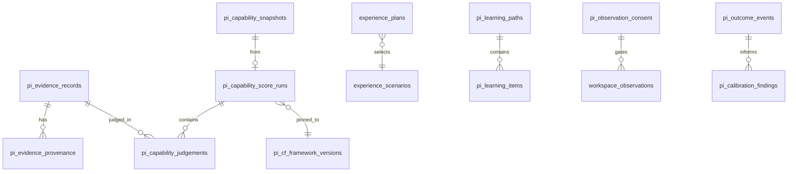

## T9 billing and entitlements (`0097`)

- `billing_customers`: one user ↔ Stripe customer identifier; optional billing email; no card/PAN data.
- `billing_subscriptions`: Stripe subscription mirror with price, SKU, lifecycle status, period end, cancellation intent.
- `billing_entitlements`: derived product access. SKUs are `experience`, `launchpad`, `professional`; Complete Journey writes all three entitlement rows.
- `billing_webhook_events`: unique Stripe event ID, type, mode, processing result, payload digest, error. Idempotency and ops audit only; no full payload/payment method.

RLS exposes self-only SELECT for customers, subscriptions and entitlements. Authenticated clients cannot mutate billing rows. Webhook/checkout writers use `service_role`. Billing person rows are in T1 export/purge; webhook operational audit is retained and does not carry PANs.

# Data Model

> **Product Bible:** Orientation in [`../README.md`](../README.md). This engineering doc is **canonical detail** for schema/APIs/phases when implementing.

**Source of truth:** `supabase/migrations/0066`–`0105` (PI pivot through T8 external attestation; Batch 1 DB trust lockdown; DB consent enforcement; Phase 5 capability child lockdown; Phase 7 search_path hygiene) on project `jibmyxaldetyycmtlxet`
**As of:** 2026-07-25

Mermaid ER diagram: **TODO** (compact domain sketch below until a full ER export is generated).

---

## Compact domain sketch

---

## Tables by domain (migrations 0066–0089)

### Onboarding — `0066`

- `pi_onboarding_sessions`

### Evidence Ledger — `0067`

- `pi_evidence_sources`
- `pi_evidence_records`
- `pi_evidence_provenance`
- `pi_evidence_status_transitions`
- `pi_evidence_interpretations`
- `pi_evidence_competency_links`
- `pi_evidence_processing_jobs`
- `pi_evidence_challenges`
- `pi_domain_events`

### Capability Engine — `0068`

- `pi_rubric_versions`
- `pi_capability_score_runs` (includes `framework_version_id`, `run_kind`, `rubric_resolve_source`)
- `pi_capability_judgements`
- `pi_capability_snapshots`
- `pi_capability_reviews`

### Experience simulation — `0069`

- `experience_sim_events`

### Professional Workspace — `0070`

- `workspace_contributions`

### Verified Portfolio — `0071` + T8 `0094`

- `vpp_entries`, `vpp_entry_evidence`, `vpp_versions`, `vpp_shares`
- **T8:** `vpp_attestation_requests` (tokenised, consent-gated), `vpp_attestations` (confirm/dispute), `vpp_attestation_events` (audit)
- Confirm → ledger `external_verification` + entry `externally_attested` / `externally_verified`
- Dispute → `pi_review_case`; never capability write
- Attestor PII minimal; not exposed on public share views
- Person attestation rows included in privacy export/purge

### Career Intelligence — `0072`

- `career_applications`, `career_activities`

### PI Review — `0073` (+ B4 ops hardening, no new migration)

- `pi_review_cases`, `pi_review_events`, `pi_review_notifications`
- Feature flag `DELIVERX_REVIEWER_QUEUE` (default off) gates API/UI surfaces
- Trust guards reject Verified / capability-write payloads; revise queues reassessment only
- Ops playbook: [`reviewer-ops-playbook.md`](./reviewer-ops-playbook.md)

### Admin competency framework — `0074`–`0076`

- `pi_cf_frameworks`, `pi_cf_framework_versions`
- `pi_cf_role_families`, `pi_cf_seniority_levels`, `pi_cf_roles`
- `pi_cf_competencies`, `pi_cf_indicators`, `pi_cf_rubric_anchors`
- `pi_cf_assessment_content`, `pi_cf_evidence_rules`
- `pi_cf_portfolio_expectations`, `pi_cf_readiness_requirements`
- `pi_cf_audit_events`
- Seed graph + framework pin backfill

### Assessment — `0077`, `0081`–`0082`

- `pi_assessment_sessions`, `pi_assessment_items`, `pi_assessment_responses`, `pi_work_samples`
- `pi_growth_reports` (final/transfer body)

### Experience planner / catalogue — `0078`–`0079`

- `experience_scenarios`, `experience_plans`
- Multi-company catalogue seed (12 companies)

### Workspace observation — `0080`

- `pi_observation_consent`
- `workspace_observations`
- `pi_interventions`, `pi_intervention_outcomes`

### Learning Intelligence — `0083`

- `pi_learning_paths`, `pi_learning_items`

### Real-world outcomes — `0084`–`0085`

- `pi_outcome_events`
- `pi_calibration_findings`

### Privacy requests — `0086` (T1)

- `pi_privacy_requests` — export/delete job status; tombstones retained after person purge
- RPC `pi_privacy_purge_person_data` — service-role person cascade; never touches `pi_cf_*`
- Advisor hygiene: `forbid_*` `search_path` locked; `pi_cf_audit_events` explicit deny-all for authenticated

### Rubric resolve audit — `0087` (T2)

- `pi_capability_score_runs.rubric_resolve_source` — `db` \| `in_code_fallback` (nullable for legacy rows)

### Artefacts & versioning — `0088`–`0089` (T3)

- `artefacts` — logical envelope (mutable metadata, `status` draft/active/submitted/archived, `current_version_id` pointer, `confidentiality` default private, optional `work_item_ref`/`activity_ref`/`source_surface`)
- `artefact_versions` — **immutable** version rows (`version_number`, `content`, `content_hash`, `contribution_source` user/ai/mixed + provenance columns); `unique (artefact_id, version_number)` and `unique (artefact_id, content_hash)`; append-only trigger `artefact_forbid_version_mutation` with purge-only DELETE bypass
- `artefact_status_transitions` — append-only submission / state-change audit
- `pi_evidence_provenance.artefact_id` / `.artefact_version_id` — FKs (`on delete restrict`) + CHECK `artefact_id is null or artefact_version_id is not null` (evidence must cite a specific version)
- Purge RPC (`0088`) extended: transitions → clear `current_version_id` → versions → envelopes, deleted **after** evidence (RESTRICT FK); never touches `pi_cf_*`
- `0089` hotfix: `revoke execute on pi_privacy_purge_person_data from anon, authenticated` (service_role only)

### AI orchestration — `0090` (T4) + citation hardening (no migration)

- `ai_agents` — platform catalogue (line_manager / stakeholder / observer / coach); not person PI; readable by authenticated
- `ai_prompt_versions` — **immutable** prompt rows (`agent_slug`, `prompt_slug`, `version`, `prompt_hash`, `output_contract`); app registry is runtime SoT (v2 citation-aware templates live in app; v1 DB seeds retained)
- `ai_interactions` — person append-only log (model, provider, tokens, latency_ms, cost_estimate_usd, prompt version, context_sources, input/output hashes, guardrail_flags); self-only RLS. App/API projections label `cost_estimate_usd` as a heuristic pilot estimate, not provider billing.
- **Citations (2026-07-26):** structured `AiCitation` in output JSON; `enforceCitations` validates against `context_sources` / evidence ids for the same run; failures logged in `error_message` + `guardrail_flags` — **no new columns / migration**
- Purge cascade extended: `ai_interactions` deleted with person data; `ai_agents` / `ai_prompt_versions` retained (catalogue exclusions)

### Person notifications & observability — `0091` (T5)

- `pi_notifications` — single person in-app inbox for review, intervention, privacy and system notices; every row has an internal contextual `href`, source identity, `(user_id, dedupe_key)` idempotency, `delivered_at` audit and `read_at`
- Legacy `pi_review_notifications` rows migrate into the consolidated table; the legacy table remains only for rollback/history compatibility
- New intervention offers create one evidence-context notification through a narrow insert trigger
- Privacy notifications are idempotently projected from self-visible `pi_domain_events`
- `pi_ai_usage_daily` — `security_invoker` daily interaction/token/cost/latency read model; underlying `ai_interactions` self-only RLS remains authoritative
- Purge/export cascade includes `pi_notifications`; the service-role-only privacy RPC wrapper deletes it before domain events

### Recommendations — `0098` (B2)

- `pi_recommendations` — canonical Professional Intelligence next-action entity; status lifecycle `generated → viewed → accepted | dismissed` (+ `accepted → completed | dismissed`); mandatory non-empty `rationale`; internal `href`; `(user_id, dedupe_key)` idempotency; `capability_assigned` / `verification_changed` CHECKed false
- `pi_recommendation_evidence` — recommendation → evidence/claim reference links (citations kept verbatim)
- `pi_recommendation_events` — append-only lifecycle audit (authenticated UPDATE/DELETE revoked); insert/update triggers write events; core fields (title/rationale/source) immutable after insert
- Typed SoT: `src/lib/recommendations/`; generation is deterministic from SnapshotClaims (no AI capability writes)
- Feature flag `DELIVERX_RECOMMENDATION_SM` (default off) gates API/UI surfaces
- Purge/export cascade includes all three tables; B2 privacy RPC wrapper deletes them before the T9 cascade

### SECURITY DEFINER grant hardening — `0092`

- Anonymous EXECUTE is false for every production SECURITY DEFINER function
- `current_org_id`, `is_workspace_project_member` and `pi_cf_version_is_readable` retain authenticated EXECUTE because active RLS policies depend on them
- Purge, auth-trigger and managed secret functions remain service-role or owner-only
- All inventoried functions have fixed search paths (`public` for DeliverX functions; empty for managed functions)

### Organisation structure — `0093` (T7)

- `departments` — org-scoped units (`organisation_id`, optional `parent_department_id`); shared org data (not person-owned)
- `teams` — org-scoped teams (optional `department_id`); shared org data
- `department_members` / `team_members` — person membership (`user_id`, `member_role` member|lead); included in T1 export/purge
- Helpers: `is_org_admin()`, `is_department_member(uuid)`, `is_team_member(uuid)` — SECURITY DEFINER, `search_path = public`, anon EXECUTE revoked (TD-016 posture)
- RLS: org members SELECT; org-admin (pm/executive) INSERT/UPDATE/DELETE
- Purge wrapper deletes membership rows then calls prior `pi_privacy_purge_person_data_t5`; departments/teams retained

### DB trust-rail lockdown — `0095` (Remediation Batch 1)

- `pi_capability_score_runs`: authenticated owner SELECT only; client INSERT/UPDATE/DELETE/TRUNCATE revoked. Engine persist callers use `createAdminClient`. UPDATE/DELETE are blocked by `trg_pi_capability_score_runs_immutable`; privacy purge DELETE remains available only under transaction-local `app.pi_privacy_delete`.
- `vpp_entries`: explicit owner SELECT/INSERT/UPDATE/DELETE policies replace broad `ALL`. `trg_vpp_entries_verified_columns` blocks setting or changing `externally_attested` / `externally_verified`; `pi_apply_vpp_attestation_state` is the service-role-only T8 path.
- `pi_evidence_status_transitions`: authenticated INSERT policy excludes `platform_verified`; a second trigger rejects direct elevated inserts. `pi_append_platform_verified_transition` is the service-role-only attestation append.
- Both privileged RPCs are `SECURITY DEFINER`, `search_path = public`, with anon/authenticated EXECUTE revoked.

### Observation consent enforcement — `0096` (R-P1-11 / DB-P1-01)

- `pi_workspace_observation_consent_allows(user, project_kind, project_id)` mirrors app effective-consent (project override wins; missing = deny).
- `trg_workspace_observations_consent` blocks NEW observation rows without active consent; does not delete history.
- `trg_pi_evidence_workspace_observation_consent` blocks NEW `workspace_observation` ledger rows without the same consent (other source types unchanged).
- No service-role bypass GUC; `workspace_observations_no_capability_chk` enforces `capability_assigned = false`.
- Functions are `SECURITY DEFINER`, `search_path = public`, EXECUTE revoked from anon/authenticated/service_role.

---

## Advisor notes

- **T1 closed:** `pi_cf_audit_events` authenticated deny-all; `forbid_*` `search_path = public`
- **TD-016 closed:** advisor 0028 anonymous SECURITY DEFINER findings cleared by `0092`; three advisor 0029 findings intentionally remain for RLS policy helpers
- **Open (ops):** leaked-password protection — founder toggle (TD-006); see [`runbook-leaked-password-protection.md`](./runbook-leaked-password-protection.md)

---

## Key invariants / CHECKs (enforced in SQL + app)

| Invariant | How |
| --- | --- |
| Append-oriented evidence history | Ledger transitions + provenance tables; forbid silent capability invent |
| Capability only via ScoreRun persist | `0095` SELECT-only client RLS + authenticated DML revoke + immutable trigger; `0103` removes authenticated judgement/snapshot child inserts; `0104` removes anon child SELECT grants; engine callers use service role |
| Framework pin | `framework_version_id` on ScoreRuns when published pin exists |
| Rubric resolve provenance (T2) | `rubric_resolve_source` + labelled API `rubricSource`; DB preferred |
| `run_kind` ∈ standard/baseline/final/transfer | Persist + assessment paths |
| Consent default deny | No `pi_observation_consent` row ⇒ observation denied in app **and** DB (`0096` INSERT triggers) |
| Learning ≠ competency | Learning persist never writes ScoreRuns |
| Outcomes ≠ external verification without attestation | Strength derivation + T8 attestation path only |
| `deliverxVerified` gate | `externally_attested` + `externally_verified` + kill switch; protected DB columns mutate only through service-role attestation RPC |
| Framework graph immutability | Triggers after seed (`0075`/`bff9d2d` family) |
| Artefact version immutability (T3) | `artefact_forbid_version_mutation` before update/delete; new content = new version row |
| Evidence cites a specific artefact version (T3) | `pi_evidence_provenance` CHECK + app guard `assertEvidenceCitesArtefactVersion` |
| Prompt version immutability (T4) | `ai_forbid_prompt_version_mutation` before update/delete |
| AI interaction append-only (T4) | `ai_forbid_interaction_mutation` (purge-only DELETE bypass) |
| Agents never write capability / verified evidence (T4) | Authority + output contracts + `runAgent` guardrails |
| AI citations required for material claims (pre-T9) | `enforceCitations` against run context; fail closed to non-claiming fallback |
| Notifications never invent capability / verification (T5) | App guard forces false audit flags; schema stores no capability fields |

Exact CHECK constraint names live in the migration SQL — treat migrations as authoritative.

---

## RLS posture (summary)

- Person PI tables: **self-only** (auth.uid() ownership) for candidate data, including `pi_notifications`; ScoreRuns, capability judgements, and capability snapshots are self-readable but service-role/engine-writable only
- Org-admin / framework admin: elevated paths for `pi_cf_*` and review admin APIs
- Public portfolio share: tokenised views that filter non-shareable / private evidence
- `pi_cf_audit_events`: authenticated deny-all (T1); service role only
- Privacy purge: service-role RPC only; request tombstones retained

See [`security-model.md`](./security-model.md).
