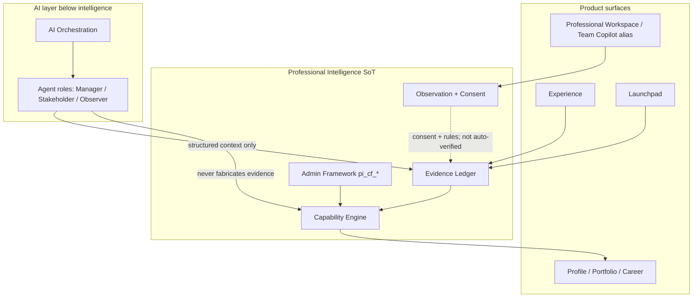
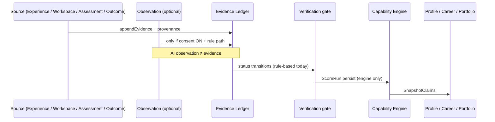
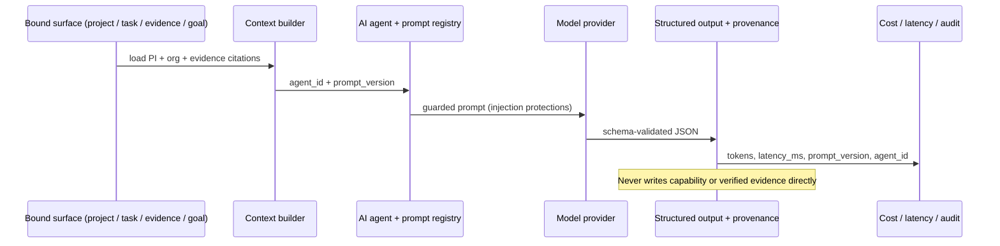

# DeliverX Technology Build Phases

**Status:** Active engineering plan (technology-oriented)  
**As of:** 2026-07-25 · T3 shipped · migrations head `0089`  
**Governed by:** [`../product/build-charter.md`](../product/build-charter.md)  
**Companion canvas:** `canvases/deliverx-technology-build-phases.canvas.tsx`  
**Contrasts with:** Product phases P0–P9 (feature journey). This plan is **modules · schema · AI · QA · ops**.

---

## Executive framing

Much of the founder's §15 build order is **already shipped** as product phases P0–P7 (Profile → ledger → capability → assessments → Experience planner + 12 companies → workspace observation + consent → growth/transfer → learning → outcomes). Production is live; migrations `0066`–`0089` are applied (T3 artefact versioning + purge lockdown hotfix).

This plan does **not** re-build P0–P7. It maps every founder module, entity, and §15 step to **Done / Partial / Missing** with evidence, then phases only the **remaining engineering work**.

| Charter posture | Technology phases |
| --- | --- |
| **Authorized now** | T0–T6 (pilot seal, privacy, rubric coherence, artefacts, AI trust layer, notifications/observability, signed-in E2E) |
| **Requires founder approval** | T7 depth (Team Copilot / Workspace expansion), T8 (P8 attestation), T9 (P9 commercial) |
| **Explicit non-goals** | Microservices split of ten intelligence domains; graph DB; employer marketplace liquidity; agent swarms |

**Recommended next engineering action:** Founder completes T0 signed-in checklist (`docs/qa/t0-signed-in-checklist.md`) — still open. **T1 + T2 + T3 shipped** (founder override while T0 PARTIAL). Do **not** start T4 (AI orchestration registry) until asked.

---

## Honest coverage snapshot

### Modules (15 founder modules)

| Status | Count | Modules |
| --- | --- | --- |
| **Done** | 5 | Professional Profile · Professional Intelligence · Experience · Evidence · Observation (consent-gated) |
| **Partial** | 9 | Identity & Access · Organisation · Projects & Work Items · Meetings & Communications · Artefacts & Documents · Capability (thin seed) · Feedback & Reflection · AI Orchestration · Audit & Analytics |
| **Missing** | 1 | Notifications (product module) — `pi_review_notifications` + org deliveries exist as stubs only |

**Working counts:** Done **5** · Partial **9** · Missing **1**.

### Entities (26 from founder DB prompt)

| Status | Count |
| --- | --- |
| **Done** (table + PI use) | 14 |
| **Partial** (exists or fragmented) | 9 |
| **Missing** | 3 (`departments`, `teams`, `messages`) |

See [Entity coverage matrix](#entity-coverage-matrix).

---

## Module relationships (modular monolith)

**Anti-duplication rules**

1. Products **read** SnapshotClaims / ScoreRuns; they do not invent parallel capability stores.
2. Learning and outcomes **must not** call Capability Engine persist.
3. Observation requires consent; coach drafts ≠ verified evidence.
4. Pre-pivot delivery/org APIs may remain; they must not override PI SoT.
5. Prefer modular monolith (`src/lib/*`) until scale justifies extraction — ten intelligence domains are **taxonomy**, not deployables.

---

## Evidence lifecycle

**Honest gap:** observation → verification is **rule-based**, not a complete human-review workflow. Human review/challenge exists (`pi_review_*`) but is not the default gate for every observation.

---

## AI request lifecycle (target for T4)

---

## Founder build-order compliance (§15)

| # | Founder step | Status | Evidence | Technology phase |
| --- | --- | --- | --- | --- |
| 1 | Repository Audit | **Done** | `current-state-audit.md`, post-ship audit canvas, HEAD `f3ac383` | T0 (refresh only) |
| 2 | Current Architecture | **Done** | `system-architecture.md`, `codebase-map.md`, constitution | T0 |
| 3 | Database Foundation | **Partial** | PI `0066`–`0089`; gaps: messages, departments/teams, AI registry | T2–T4, T7 |
| 4 | Auth & Onboarding | **Partial** | Supabase Auth, `pi_onboarding`, gates; **T1** export/deletion shipped (`0086`); leaked-password still **Open — founder action** (TD-006; runbook) | T1 done · T6 E2E |
| 5 | Organisation Intelligence | **Partial** | `organisations`, `projects`, `stakeholders`; no `departments`/`teams`; not PI-first | T7 (approval for depth) |
| 6 | First Experience & Project | **Done** | Experience planner + sim, 12 companies, `0078`–`0079` | — |
| 7 | Artefact Submission | **Done (versioning)** | **T3 (`0088`):** `artefacts` + immutable `artefact_versions` + submission audit; evidence cites `artefact_version_id`. Legacy `documents` / `launchpad_artefacts` remain | T3 shipped |
| 8 | Observation & Feedback | **Partial** | Consent + `workspace_observations` + interventions; feedback/reflection fragmented | T0/T5 |
| 9 | Evidence Engine | **Done** | Ledger `0067`, append-only + provenance | — |
| 10 | Professional Intelligence | **Done** (seed thin) | Capability Engine `0068`, SnapshotClaims, `/profile`; 3 competencies | T2 |
| 11 | AI Manager & Stakeholder | **Partial / Missing registry** | Delivery AI prompts + `agent_workflow_runs`; no formal PI agent/prompt/cost registry | T4 |
| 12 | End-to-End QA | **Missing** (signed-in) | Unit/integration ~225+ PI tests; unauth smoke; **no signed-in E2E** | T0 then T6 |
| 13 | Launchpad Foundation | **Partial** | `/launchpad`, career-intelligence, artefacts; marketplace deferred | T7 packaging only if authorized; depth blocked |
| 14 | Team Copilot Foundation | **Partial** | `/workspace` + contributions + observation; SKU ADR open; mission-control blocked | T7 **Requires approval** |

---

## Technology phases

T1–T3 migrations are shipped through `0089`. Remaining migration numbers below are **indicative plans** starting at the next free number, `0090`; do not apply them until the phase is authorized and implemented.

### T0 — Pilot seal (signed-in QA + critical debt)

| Field | Content |
| --- | --- |
| **Objective** | Prove the shipped P0–P7 loop with a real signed-in journey; close High/Medium defects that destroy pilot trust. |
| **§15 / modules** | Steps 1–2, start of 12 · Identity & Access · Audit |
| **Charter** | **Authorized now** |
| **Entry** | Build Charter active; migrations `0066`–`0085` on prod; unauth smoke green |
| **Work packages** | Manual QA checklist in `current-state-audit.md`; fix TD-001–TD-006, TD-009, TD-011 as found; coach deep-link (`TD-002`); auth path-guard honesty (`TD-003`); marketing copy vs ledger (`TD-011`) |
| **Schema** | None unless a defect requires a hotfix migration (`0086` reserved for emergency) |
| **API / AI / UX** | Defect-driven only; no new product surfaces |
| **Data deltas** | None planned |
| **Contracts/events** | None |
| **Security** | Confirm self-only RLS on person PI tables during QA |
| **Testing** | Manual signed-in checklist; file defects with repro; extend unit tests for each fix |
| **Observability** | Capture QA notes; prefer `pi_domain_events` already present |
| **Exit** | Checklist complete; High defects filed or fixed; empty ScoreRun/outcome tables either populated by QA or explained |
| **Rollback** | Revert fix PRs; no schema |

---

### T1 — Privacy, consent, export & deletion

| Field | Content |
| --- | --- |
| **Objective** | Operationalise GDPR-style **user data export** and **account/data deletion** for person PI; close advisor hygiene that weakens trust. |
| **§15 / modules** | Step 4 · Identity & Access · Audit |
| **Charter** | **Authorized now** |
| **Entry** | T0 High defects understood |
| **Status (2026-07-25)** | **Shipped** under founder override while T0 signed-in QA remains open. Migration `0086`; `src/lib/pi-privacy/`; `/api/pi/privacy/export` + `/delete`; settings UX; TD-004/005 closed; TD-006 still Open — founder Auth toggle (runbook 2026-07-25). |
| **Work packages** | `src/lib/pi-privacy/` export + delete orchestrators; settings UX; `TD-004` `search_path` on `forbid_*`; `TD-005` `pi_cf_audit_events` RLS posture; `TD-006` leaked-password protection (dashboard) |
| **Schema** | `0086_pi_privacy_requests.sql` — `pi_privacy_requests` (export/delete job status); optional tombstone audit |
| **API** | `POST/GET /api/pi/privacy/export`, `POST /api/pi/privacy/delete` (auth + confirm) |
| **Data deltas** | Privacy request entity; soft-delete/cascade map for `pi_*` person tables |
| **Contracts/events** | `privacy.export.requested`, `privacy.delete.completed` on `pi_domain_events` |
| **Security** | Least privilege; delete requires re-auth; never export others' data; retain legal audit minimum |
| **Testing** | Unit: cascade map completeness; integration: export JSON shape; no cross-user leak |
| **Observability** | Audit every privacy action |
| **Exit** | User can export PI data and request deletion; advisors for `forbid_*` / audit RLS addressed or documented |
| **Rollback** | Feature-flag off endpoints; keep table |

---

### T2 — Framework / rubric coherence (pm-core pilot)

| Field | Content |
| --- | --- |
| **Objective** | Make **DB `pi_cf_*` the source of truth** for ScoreRuns; label or remove in-code fallback drift (`TD-009`); keep seed single-domain. |
| **§15 / modules** | Steps 3, 10 · Capability · Professional Intelligence |
| **Charter** | **Authorized now** (coherence only — **not** multi-profession expansion) |
| **Entry** | T0 complete enough that ScoreRuns will be created in pilot |
| **Status (2026-07-25)** | **Shipped**. Migration `0087`; `rubric-resolve-policy` + hardened `resolve-rubric` / `rubric-bridge`; pin assert on `POST /api/pi/capability/run`; catalogue fallbacks labelled `in_code_fallback`; golden ScoreRun harness; TD-009 closed; TD-007 deferred. |
| **Work packages** | Harden `resolve-rubric.ts` / `rubric-bridge.ts`; fail closed or loudly label when falling back; seed depth only if founder OK (`TD-007` deferred by default); golden reproducibility harness in CI |
| **Schema** | `0087_rubric_resolve_audit.sql` — `rubric_resolve_source` on `pi_capability_score_runs` (`db` \| `in_code_fallback`) |
| **API** | No new routes; assert pin on `POST /api/pi/capability/run` |
| **Data deltas** | ScoreRuns record resolve provenance; prefer `framework_version_id` on every new ScoreRun |
| **Contracts** | Rubric resolve result includes `source: db \| in_code_fallback` |
| **Security** | Admin-only framework mutation unchanged; `DELIVERX_RUBRIC_REQUIRE_DB` fail-closes fallback |
| **Testing** | Contract test: DB graph vs in-code codes; golden ScoreRun reproducibility |
| **Observability** | Log fallback rate (`[rubric-resolve] in_code_fallback`); column + result JSON |
| **Exit** | Pilot ScoreRuns resolve from published `pm-core@2026.1` graph; fallback measurable and rare |
| **Rollback** | Keep in-code fallback behind explicit env (`DELIVERX_RUBRIC_ALLOW_IN_CODE_FALLBACK`; unset REQUIRE_DB) |

**Requires founder approval:** expanding beyond 3 competencies / multi-profession platforms.

---

### T3 — Artefact versioning & submission coherence

| Field | Content |
| --- | --- |
| **Objective** | Introduce a first-class **artefact version** model and wire submissions into the ledger without duplicating PI data. |
| **§15 / modules** | Step 7 · Artefacts & Documents · Evidence |
| **Charter** | **Authorized now** (trust/honesty of evidence packaging) |
| **Status (2026-07-25)** | **Shipped** (`c2819b3`). Migration `0088`: `artefacts`, `artefact_versions` (immutable, content hash, user-vs-AI provenance), `artefact_status_transitions` (append-only submission audit). Evidence provenance cites `artefact_version_id` (DB CHECK + app guard `assertEvidenceCitesArtefactVersion`). Self-only RLS, private by default; added to T1 export/purge cascade. `src/lib/artefacts/`; `POST/GET /api/pi/artefacts` + `/[id]/versions`; settings panel. **Hotfix `0089`** revoked anon/authenticated EXECUTE on `pi_privacy_purge_person_data` (Supabase default-privilege leak found during access-control check). 21 new tests; 890 vitest pass; prod READY; unauth 401. |
| **Entry** | T1 privacy map aware of new tables |
| **Work packages** | Unify conceptual model over `documents`, `launchpad_artefacts`, contribution artefact refs; `src/lib/artefacts/`; link versions to `pi_evidence_records` |
| **Schema** | `0088_artefact_versions.sql` — `artefacts`, `artefact_versions` (immutable version rows, content hash, created_by) |
| **API** | `POST /api/pi/artefacts`, `POST /api/pi/artefacts/[id]/versions` |
| **Data deltas** | artefacts · artefact_versions; FKs from evidence provenance |
| **Contracts/events** | `artefact.version.created` |
| **Security** | Self-only RLS; private by default |
| **Testing** | Immutability of prior versions; evidence cannot point at mutable blob without version id |
| **Observability** | Provenance includes `artefact_version_id` |
| **Exit** | New submissions create versioned artefacts; ledger cites version ids |
| **Rollback** | Stop writing new tables; legacy paths remain |

---

### T4 — AI orchestration trust layer

| Field | Content |
| --- | --- |
| **Objective** | Formalise founder §11 agent framework **without** making chat the database: role registry, authority boundaries, context builder, structured outputs, provenance, guardrails, prompt-injection protections, cost/latency logging, mock-model tests. |
| **§15 / modules** | Step 11 · AI Orchestration |
| **Charter** | **Authorized now** for **trust infrastructure**. Full “AI Line Manager product UX” expansion → **Requires founder approval** if it becomes a new Home or SKU surface. |
| **Entry** | T2 rubric SoT stable (agents must cite framework pins) |
| **Work packages** | `src/lib/ai-orchestration/`: `agents` (line_manager, stakeholder, observer), `context-builder`, `output-contracts`, `guardrails`, `prompt-registry`, `usage-log`; wrap existing `src/lib/ai/*` |
| **Schema** | Indicative `0090_ai_orchestration.sql` — `ai_agents`, `ai_prompt_versions`, `ai_interactions` (tokens, latency_ms, model, prompt_version, agent_id, input/output hashes) |
| **API** | Internal first; optional `GET /api/pi/ai/interactions` (self) |
| **Data deltas** | AI agents · AI interactions · prompt versions |
| **Contracts** | Zod/JSON Schema per agent; refuse unstructured capability writes |
| **Security** | Prompt-injection denylist/sandbox; never elevate observation to verified; cost caps |
| **Testing** | Mock-model unit tests; schema validation failures; injection fixture suite; eval harness smoke |
| **Observability** | Mandatory cost/latency on every call |
| **Exit** | Observer/Manager/Stakeholder calls go through registry; every call logged; mock tests in CI |
| **Rollback** | Bypass registry behind env for legacy delivery AI only |

---

### T5 — Notifications & PI observability

| Field | Content |
| --- | --- |
| **Objective** | Replace fragmented stubs (`pi_review_notifications`, org notification deliveries) with a minimal **person PI notifications** module and coherent audit/analytics read models for pilot ops. |
| **§15 / modules** | Steps 8, 14 area · Notifications · Audit & Analytics |
| **Charter** | **Authorized now** (pilot ops). Slack/Teams enterprise fan-out already partial — do not expand channels without need. |
| **Entry** | T4 interactions exist to notify on |
| **Work packages** | `src/lib/notifications/`; in-app inbox on `/profile` or settings; wire review + intervention + privacy events |
| **Schema** | Indicative `0091_pi_notifications.sql` — `pi_notifications` (user_id, kind, payload, read_at) |
| **API** | `GET/PATCH /api/pi/notifications` |
| **Data deltas** | pi_notifications |
| **Contracts/events** | Consume `pi_domain_events` |
| **Security** | Self-only |
| **Testing** | No cross-user leak; idempotent create from events |
| **Observability** | Notification delivery audit field |
| **Exit** | Pilot user sees in-app notifications for review/privacy/intervention; ops can query interaction costs |
| **Rollback** | Hide inbox UI; keep table |

---

### T6 — Signed-in E2E & release gates

| Field | Content |
| --- | --- |
| **Objective** | Automate the T0 checklist as signed-in E2E + per-phase release gates so “works” is never claimed from unit tests alone. |
| **§15 / modules** | Step 12 · cross-cutting |
| **Charter** | **Authorized now** |
| **Entry** | T0 manual path green at least once |
| **Work packages** | Playwright (or repo-standard) person journey; CI job with secret test user; gate script: typecheck · lint · unit · e2e-smoke |
| **Schema** | None |
| **API** | Test against existing contracts |
| **Testing** | E2E: profile → baseline or Experience → ledger → ScoreRun pin → consent OFF → learning no capability → outcomes no external verify → portfolio Verified off |
| **Observability** | CI artefacts / traces |
| **Exit** | CI blocks merge on E2E failure for PI paths; TD-001 closed |
| **Rollback** | Mark E2E non-blocking temporarily with explicit charter note |

---

### T7 — Launchpad & Team Copilot foundations (bounded)

| Field | Content |
| --- | --- |
| **Objective** | Harden foundations **without** marketplace or enterprise mission-control. |
| **§15 / modules** | Steps 5, 13, 14 · Organisation · Launchpad · Projects |
| **Charter** | Launchpad packaging honesty: **Authorized** if it only consumes SnapshotClaims. **Team Copilot / Workspace depth, org departments/teams modelling, mission-control: Requires founder approval** (ICP + SKU ADR). |
| **Entry** | T6 gates green; founder decisions on ICP/SKU preferred |
| **Work packages** | Label heuristic readiness; demote non-MVP workspace modules; optional thin `departments`/`teams` **only after approval** |
| **Schema** | If approved: indicative `0092_org_structure.sql` — departments, teams |
| **Exit** | Documented foundation boundaries; no marketplace; no Verified badge without attestation |
| **Rollback** | Hide surfaces via `DELIVERX_PI_SURFACES` |

---

### T8 — External attestation (product P8)

| Field | Content |
| --- | --- |
| **Objective** | Employer/attestor path so `deliverxVerified` can light honestly. |
| **Charter** | **Requires founder approval** (legal/product meaning of Verified) |
| **Schema (indicative)** | `0093_external_attestation.sql` |
| **Exit** | Attestation record + strength `externally_verified` path; badge lights only then |

---

### T9 — Commercial packaging (product P9)

| Field | Content |
| --- | --- |
| **Objective** | Entitlements / monetisation beyond hardcoded `open`. |
| **Charter** | **Requires founder approval** |
| **Exit** | Honest pricing + entitlement checks; no trust regressions |

---

## Module × Phase matrix

| Module | Today | T0 | T1 | T2 | T3 | T4 | T5 | T6 | T7 | T8–T9 |
| --- | --- | --- | --- | --- | --- | --- | --- | --- | --- | --- |
| Identity and Access | Partial | harden | **export/delete** | | | | | E2E auth | | |
| Professional Profile | Done | QA | | | | | notify | E2E | | |
| Professional Intelligence | Done | QA | | rubric SoT | | agents cite | | E2E | | |
| Organisation | Partial | | | | | | | | **approval** | |
| Experience | Done | QA | | | | | | E2E | | |
| Projects and Work Items | Partial | | | | | context | | | demote/keep | |
| Meetings and Communications | Partial | | | | | | | | thin bridge* | |
| Artefacts and Documents | Partial | | privacy map | | **versions ✓** | | | | | |
| Observation | Done | QA | consent UX | | | Observer agent | | E2E | | |
| Evidence | Done | QA | | | cite versions | | | E2E | | |
| Capability | Partial seed | | | **coherence** | | | | E2E | | |
| Feedback and Reflection | Partial | | | | | | notify | | | |
| AI Orchestration | Partial | | | | | **registry** | usage UI | | | |
| Notifications | Missing module | | | | | | **module** | | | |
| Audit and Analytics | Partial | QA notes | privacy audit | fallback metrics | | cost logs | inbox ops | CI | | P8 audit |

\*Meetings/messages PI bridge only if it hardens evidence honesty; not mission-control.

---

## Entity coverage matrix

| # | Founder entity | Today | Table / evidence | Plan |
| --- | --- | --- | --- | --- |
| 1 | users | **Done** | `users` (`0001`) | Keep |
| 2 | professional profiles | **Partial** | `pi_onboarding_sessions`, `launchpad_profiles`, `xperience_profiles`, `/profile` aggregate | Unify read model; avoid duplicate SoT |
| 3 | career goals | **Partial** | `launchpad_profiles.career_goal`, onboarding payload | Keep; no parallel store |
| 4 | organisations | **Done** | `organisations` | Keep |
| 5 | departments | **Missing** | — | T7 **if approved** |
| 6 | teams | **Missing** | — | T7 **if approved** |
| 7 | roles | **Partial** | `user_role` enum + `pi_cf_roles` | Keep dual meaning documented |
| 8 | stakeholders | **Partial** | `stakeholders` (`0016`) | Delivery OS; PI cite via evidence |
| 9 | experiences | **Done** | `experience_scenarios`, `experience_plans`, xperience | Keep |
| 10 | projects | **Done** | `projects` | Keep |
| 11 | work items | **Done** | `tasks` | Keep as work items |
| 12 | meetings | **Partial** | `meetings` (`0012`) — thin PI link | Optional evidence bridge |
| 13 | messages | **Missing** | No first-class `messages` table | Only if needed for evidence; else use meeting notes / contributions |
| 14 | artefacts | **Done** | `artefacts` (`0088`) first-class envelope; legacy `documents` / `launchpad_artefacts` remain | T3 shipped |
| 15 | artefact versions | **Done** | `artefact_versions` (`0088`) immutable + provenance; evidence cites version | **T3 shipped** |
| 16 | observations | **Done** | `workspace_observations`, consent | Keep |
| 17 | evidence items | **Done** | `pi_evidence_records` + provenance | Keep |
| 18 | evidence verification | **Partial** | Status transitions + review; rule-based, not full human gate | Harden honesty; P8 for external |
| 19 | capabilities | **Done** | judgements / snapshots | Engine-only writes |
| 20 | capability definitions | **Partial** | `pi_cf_competencies` (3) | T2 coherence; expand only with approval |
| 21 | evidence→capability mappings | **Done** | `pi_evidence_competency_links`, `pi_cf_evidence_rules` | Keep |
| 22 | feedback | **Partial** | review cases, interventions | Notifications T5 |
| 23 | reflections | **Partial** | sim reflect API; evidence source `reflection` | Keep; optional table later |
| 24 | recommendations | **Partial** | Various services; not first-class PI table | Prefer derived + explainable; table only if tracked attribution needed |
| 25 | AI agents | **Partial** | `agent_workflow_runs.routed_agents` strings | **T4** `ai_agents` |
| 26 | AI interactions | **Partial** | `agent_activity_events` (no cost/latency standard) | **T4** `ai_interactions` |
| 27 | audit events | **Partial** | `pi_domain_events`, `pi_cf_audit_events` | T1/T5 harden |

*(Founder list is 26 named entities; audit events included as the 27th operational entity from the same DB prompt family.)*

---

## Cross-cutting tracks

### Modular monolith boundaries

- Domain logic in `src/lib/<domain>`; Route Handlers thin.
- No new microservice for an intelligence domain without scale justification (Foundation / `07-intelligence-architecture` synthesis).
- Do not duplicate Professional Intelligence across Experience / Launchpad / Workspace.

### Migration / versioning strategy

- Additive migrations only for person PI; next free numbers start at **`0090`** (head `0089`).
- Framework versions immutable after publish; ScoreRuns pin `framework_version_id`.
- Artefact versions immutable; new upload = new version row.
- Prompt versions immutable; `ai_interactions` reference `prompt_version`.

### AI provenance, guardrails, evals

- Platform owns intelligence; LLMs reason over structured context.
- Observation ≠ evidence ≠ capability.
- Every agent output: schema + citations + `prompt_version` + cost/latency.
- Mock-model tests required before enabling new agent roles in prod.
- Prompt-injection fixtures in CI (T4).

### Privacy / consent / export / deletion

- Observation consent default OFF (`PD-2026-07-04`).
- Evidence private by default.
- T1 implements export + deletion orchestration across `pi_*` (and documents mapped in the privacy graph).

### Testing pyramid & release gates

| Layer | Now | Per authorized phase |
| --- | --- | --- |
| Unit / domain | ~225+ PI cases | Required for touched modules |
| Invariant tests | Hold (charter rails) | Extend when rails change |
| Unauth smoke | Pages 307 / APIs 401 | Keep |
| Signed-in manual | **Required T0** | Before claiming pilot |
| Signed-in E2E | Missing → **T6** | Release gate |
| AI eval / mock | Sparse → **T4** | Before new agents |

### Technical debt burn-down

| ID | Phase | Notes |
| --- | --- | --- |
| TD-001 | T0 → T6 | Signed-in E2E |
| TD-002 | T0 | Coach deep-link |
| TD-003 | T0 | Proxy vs layout guards |
| TD-004–006 | T1 | **TD-004/005 closed in `0086`**; TD-006 still Open — founder Attack Protection / `password_hibp_enabled` (runbook) |
| TD-007 | Deferred | Thin seed OK unless founder expands |
| TD-008 | Deferred | Env gate enough; full flag platform later |
| TD-009 | T2 | **Closed** — labelled fallback + resolve audit column |
| TD-010 | T7 approval | SKU ADR |
| TD-011 | T0 | Marketing vs ledger |
| TD-012–014 | Deferred | Dual-write / ER / pre-pivot surface |

---

## Explicit non-goals (founder reasoning preserved)

| Non-goal | Why |
| --- | --- |
| **Microservices for ten intelligence domains** | Domains are ownership/taxonomy; split only when scale/team isolation requires it (`07` synthesis + constitution). |
| **Graph database** | Explicit relational schemas + typed contracts preferred; graph adds ops cost without active use case. |
| **Employer marketplace liquidity / opportunity OS** | Deferred vs Launchpad packaging + readiness loop; charter blocks broad marketplace. |
| **Agent swarms / chat-as-DB** | Intelligence belongs to the platform; agents consume structured context; chat history is not the primary database. |
| **P8 / P9 without approval** | Verified badge and monetisation must not outrun trust and legal meaning. |
| **Multi-profession framework platforms** | Pilot is `pm-core`; expansion is a founder decision. |

---

## Related documents

- [`../product/build-charter.md`](../product/build-charter.md)
- [`../product/current-scope.md`](../product/current-scope.md)
- [`../product/product-decisions.md`](../product/product-decisions.md)
- [`system-architecture.md`](./system-architecture.md)
- [`data-model.md`](./data-model.md)
- [`api-contracts.md`](./api-contracts.md)
- [`security-model.md`](./security-model.md)
- [`testing-strategy.md`](./testing-strategy.md)
- [`current-state-audit.md`](./current-state-audit.md)
- [`technical-debt-register.md`](./technical-debt-register.md)
- [`../architecture/00-deliverx-foundation.md`](../architecture/00-deliverx-foundation.md) … `07`
